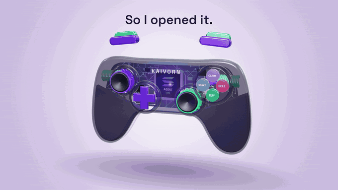
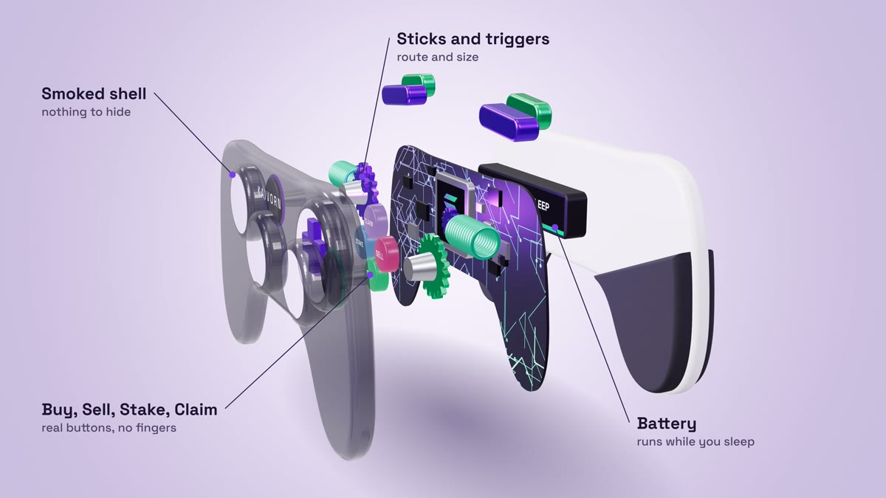
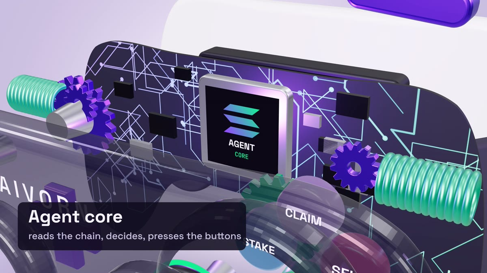
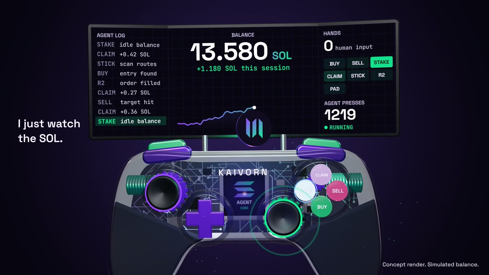
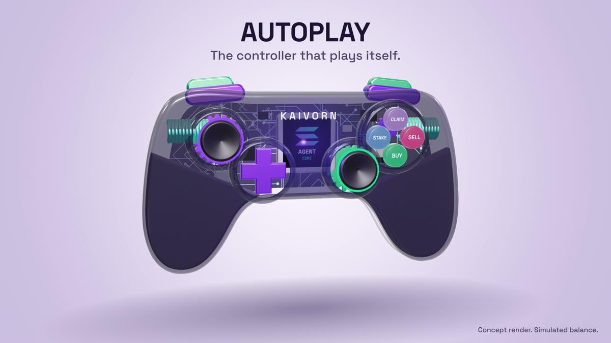

<div align="center">

# AUTOPLAY

### The controller that plays itself. Agent: AFK.

A one take 3D film about a game controller nobody is holding, written entirely in code.
It unpacks layer by layer, folds out into a trading terminal, and presses its own buttons.

**[Open the live scene](https://kaivornxbt.github.io/autoplay-controller/)** · [Watch the MP4](media/autoplay-controller.mp4) · [How it works](#how-it-works) · [Render your own](#render-your-own)



</div>

> [!IMPORTANT]
> **AFK is a character, not a bot.** This repo has no trading logic, no wallet code, no RPC calls and no keys.
> Every button press comes from a hand written timeline and the SOL balance is a list of nine numbers.
> There is no token and nothing to buy. If someone sells you "the AFK bot", it isn't from here.

## The pitch

Every trading terminal looks the same: dark panels, tiny numbers, a person hunched over them clicking.

So what if the terminal was a toy?

AUTOPLAY takes the most human piece of hardware there is, a gamepad, and removes the human. The sticks drift on their own. BUY lights up. R2 fires. CLAIM spits a coin out of the right stick and into the balance. The **HANDS** counter on the screen says `0` for the entire film.

It's a joke about automation, and also a small love letter to product teardown videos.

## The film, shot by shot

One camera, no cuts, 22.8 seconds.

| Time | What you see | On screen |
|---|---|---|
| `0:00` | The controller floats in a pearl studio. Buttons press by themselves | *Nobody is holding this controller.* |
| `0:02.4` | Shoulders lift, the board wakes up under the smoked shell | *So I opened it.* |
| `0:03.6` | Layers fly apart while the camera orbits to the side | Callouts for each part |
| `0:07.5` | Camera dives through the glass to the chip | *Agent core: reads the chain, decides, presses the buttons* |
| `0:08.4` | Six layers snap back, one per eighth note | |
| `0:10.2` | Studio lights die. A screen rises from behind the body | *Then it unfolds.* |
| `0:10.8` | Two side panels swing open into a curved triple display | `AUTOPLAY` boot |
| `0:12.0` | AFK takes over. 24 presses in 7.2 seconds | *The agent presses.* / *I just watch the SOL.* |
| `0:19.2` | Everything folds away, the lights come back | |
| `0:20.7` | End card | *The controller that plays itself.* |

<table>
<tr>
<td></td>
<td></td>
</tr>
<tr>
<td></td>
<td></td>
</tr>
</table>

## Anatomy of the controller

Everything is procedural geometry. No models were imported.

| Part | How it's made |
|---|---|
| Body | One hand drawn half outline, mirrored, then extruded with a bevel |
| Smoked shell | Same outline with four holes cut in it, a physical material with clearcoat at 60% opacity |
| Grips | The outline filtered below a slanted line, with a stipple bump map drawn on a canvas |
| Board | Random 45 degree trace walks painted in a violet to mint gradient, used as both colour and emissive map |
| Agent core | A steel package with a canvas texture on top |
| Gears | Teeth generated around a circle, one set per stick and per shoulder, spinning faster during the teardown |
| Coils | Twelve torus rings per side |
| Buttons and stick caps | Lathed profiles with real travel, a flash and an expanding ring on each press |
| Terminal | Three hinged panels sharing a single 2408 by 860 canvas through remapped UVs |
| Backdrop | A full screen shader that goes pearl to violet flash to indigo |

## How it works

The whole film is one pure function:

```js
window.__R.seek(t)   // t in seconds → the exact frame
```

Nothing accumulates between frames. No physics, no `deltaTime`, no random state. Layer offsets, camera position, button travel, the terminal log, the chart and every spark are computed from `t` alone. That is what makes the same file work as a live page and as a frame perfect offline render.

The timeline is the single source of truth. `render/make_film.py` generates one list of events:

```json
{ "t": 12.9, "b": "CLAIM", "tag": "CLAIM", "d": 0.31, "log": "+0.31 SOL" }
```

and that same list drives both sides:

```
                ┌─▶ scene.src.html   button travel, coin, sparks, log line, balance
events() ───────┤
                └─▶ score.py         the sound of that exact press
```

So when you see CLAIM light up, you hear a CLAIM on the same sample. There's no syncing by eye, because there is nothing to sync.

### AFK's whole brain

Here is the entire "agent", in full. An eight step loop on eighth notes:

```python
L stick  → "scan routes"
BUY      → "entry found"
R2       → "order filled"
CLAIM    → "+0.31 SOL"
SELL     → "target hit"
CLAIM    → "+0.18 SOL"
STAKE    → "idle balance"
CLAIM    → "+0.42 SOL"
```

Three loops, nine claims, 2.79 SOL that never existed.

## The sound

Every note and effect is synthesized in `render/score.py` with NumPy. No samples.

| Layer | Source |
|---|---|
| Lead | Pulse wave with delayed vibrato |
| Arps | 12.5% pulse, panned hard on alternate sixteenths |
| Bass | Triangle quantized to four bit stairs |
| Drums | Pitch dropped triangle kick, sample and hold noise for snare and hats |
| Bells | Two operator FM with a short tap echo |
| Plastic clacks | Three damped resonances plus a burst of noise |
| Servos | Lowpassed square sweeps |

100 BPM, B minor, Bm G D A. At 30 fps an eighth note is exactly 9 frames, so every snap lands exactly on a frame. Each action has its own voice, and CLAIM is a rising triple tone that climbs the scale as the session goes on.

## Run it

The live scene is a static page. Clone it and serve the folder:

```bash
git clone https://github.com/kaivornxbt/autoplay-controller
cd autoplay-controller
python -m http.server 8000
```

Then open `http://localhost:8000`. No build step and no install. Sound stays off until you press the button, as browsers require.

## Render your own

You need Python 3.10+ and [FFmpeg](https://ffmpeg.org) on your PATH.

```bash
pip install -r render/requirements.txt
playwright install chromium
cd render
python make_film.py
```

That builds the scene, captures 684 frames in headless Chromium at double resolution, downsamples them to 1080p, composes the score from the same events and muxes `render/out/autoplay-controller.mp4`.

```bash
python make_film.py --qa 0.5 6.5 16.2   # contact sheet of any timestamps
python make_film.py --audio             # rescore, keep the picture
```

## Make it yours

Good places to start poking:

- `events()` in `make_film.py`: rewrite AFK's routine, and picture and sound both follow
- `K` in `scene.src.html`: the camera path, as plain keyframes
- `DIST`, `OPENS`, `CLACKS`: how far each layer travels and when it snaps home
- `VIO` and `MNT`: the two colours that run the whole look
- `drawScreen()`: everything shown on the terminal

## FAQ

**Does it trade?** No. See the box at the top.

**Can I connect a wallet?** There is nothing to connect it to.

**Is there a token?** No, and there won't be one attached to this repo.

**Then why does it say it earned SOL?** Because it's a film. The balance is scripted and the video says so on screen.

**Why a controller?** Because a bot that clicks for you is funnier when you can see the thumbs are missing.

**Is that the Solana logo?** A drawn nod to it, used to say what the fictional agent is farming. This project isn't affiliated with or endorsed by Solana.

## Project layout

```
index.html              the live scene
vendor/three-bundle.js  Three.js with RoomEnvironment
media/                  film, audio, stills
render/
  scene.src.html        the 3D scene and the terminal UI
  make_film.py          event list, frame capture, encode
  score.py              the soundtrack
```

## Credits

Built by [Kaivorn](https://x.com/kaivornxbt). Rendered with [Three.js](https://threejs.org), set in Space Grotesk and JetBrains Mono.

Code under the [MIT License](LICENSE). Not financial advice, not a product, not a bot. It's a controller that plays itself.
